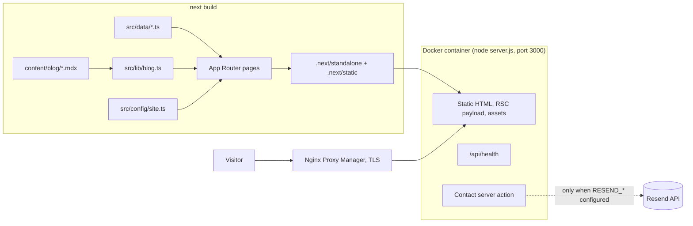
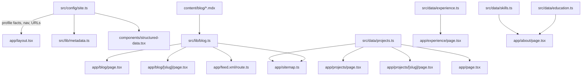

# Architecture

## Summary

A statically generated Next.js 16 App Router site. Every public page is prerendered at build time from TypeScript data files and MDX content. The runtime server (Next.js standalone) serves the prerendered HTML and static assets, answers `/api/health`, and hosts one server action for the contact form. There is no database and no authentication.



## Rendering model

| Route | Strategy | Notes |
| --- | --- | --- |
| `/`, `/about`, `/experience`, `/uses`, `/contact`, `/resume`, `/privacy`, `/projects`, `/blog` | Static | Read data at build time |
| `/projects/[slug]` | SSG with `generateStaticParams`, `dynamicParams = false` | Unknown slugs produce the 404 page |
| `/blog/[slug]` | SSG with `generateStaticParams`, `dynamicParams = false` | Only `status: published` posts are generated |
| `/sitemap.xml`, `/robots.txt`, `/manifest.webmanifest`, `/opengraph-image`, `/icon.svg` | Metadata file conventions, static | Generated from `src/config/site.ts` and data |
| `/feed.xml` | Route handler, `force-static` | RSS 2.0 of published posts |
| `/api/health` | Route handler, `force-dynamic` | Returns `{"status":"ok"}` |
| `not-found.tsx` | Static | Custom 404 shared by all segments |

Client components are limited to what needs browser state: theme provider/toggle, mobile navigation sheet, project filter, `NavLink` (reads `usePathname`), `Reveal` (in-view motion), table of contents, and the contact form (`useActionState`).

## Frontend and server boundaries

- **Server-only modules** (`import "server-only"`): `src/lib/blog.ts` (filesystem reads), `src/lib/contact.ts` (secrets and rate limiter), `src/lib/resume.ts` (filesystem check). They can never be bundled into the client.
- **Server action:** `src/app/contact/actions.ts` (`"use server"`) is the only mutation surface. It validates with Zod, checks a honeypot, applies an in-memory rate limit keyed by `x-forwarded-for`, and calls Resend. It returns an error state without side effects when `RESEND_API_KEY`, `CONTACT_TO_EMAIL`, or `CONTACT_FROM_EMAIL` is missing.
- **Environment variables:** `NEXT_PUBLIC_SITE_URL` is inlined at build time (Docker build argument). The three contact variables are read at request time in the container.

## Data flow



Rules that keep the data flow honest:

- Page components hold no profile facts; everything comes from `src/config/site.ts` or `src/data/*`.
- Optional facts (`email`, `githubUrl`, `linkedinUrl`, `location`) are `undefined` until supplied and the UI omits the corresponding element.
- `employmentDatesVerified: false` hides date ranges on the experience timeline.
- `getPublishedPosts()` is the single filter for drafts and is used by the listing, article route, feed, sitemap, and homepage.

## Component hierarchy

```text
RootLayout (app/layout.tsx)
├── ThemeProvider (next-themes, class attribute, default dark)
│   ├── Skip link
│   ├── SiteHeader
│   │   ├── Logo
│   │   ├── nav[aria-label=Primary] > NavLink × 6
│   │   ├── ThemeToggle
│   │   ├── Résumé button (PDF if present, else /resume)
│   │   └── MobileNav (Sheet) — md:hidden
│   ├── <main id="main">{page}</main>
│   ├── SiteFooter (navigation, SocialLinks or "not configured" text, © year)
│   └── StructuredData (Person + WebSite JSON-LD)
```

Reusable building blocks: `SectionHeading`, `PageHeader`, `Reveal`, `ProjectCard`, `ProjectMockup`, `ArchitectureDiagram`, `ExperienceTimeline`, `PostCard`, `TableOfContents`, `SocialLinks`, shadcn `Button`, `Badge`, `Sheet`, `Separator`.

## Styling architecture

Tailwind v4 CSS-first configuration in `src/app/globals.css`:

- `:root` defines the dark palette; `.light` overrides it. `@custom-variant dark (&:is(.dark *))` keeps shadcn's `dark:` utilities working.
- `@theme inline` maps CSS variables to Tailwind tokens (`bg-surface`, `text-brand`, `text-foreground-secondary`, `text-display`, `container-content`, and so on).
- Custom utilities: `container-content`, `eyebrow`, `surface-card`, `grid-texture`.
- `.prose-article` styles MDX output; Shiki dual-theme tokens are selected with `code[data-theme] span { color: var(--shiki-dark) }` and the `.light` counterpart.
- `prefers-reduced-motion` disables transitions globally; `Reveal` also checks `useReducedMotion()`.

## Deployment architecture

```mermaid
flowchart LR
  Internet --> DNS[DNS A/AAAA record\nKapilSahrma.mageiatech.com\n(Needs Confirmation)]
  DNS --> NPM[Nginx Proxy Manager\nTLS termination]
  NPM -->|http://host:3005| Container[kapil-portfolio container\nnode server.js :3000\nuser nextjs]
  Portainer[Portainer stack] -. manages .-> Container
```

- Image: multi-stage `Dockerfile` (deps → builder → runner) on `node:24-alpine`, non-root `nextjs` user, `HEALTHCHECK` against `/api/health`.
- Compose: `docker-compose.yml` maps `${HOST_PORT:-3005}` to container port 3000, `restart: unless-stopped`, log rotation, optional contact variables.
- Persistent state: none. The container is fully replaceable; rollback is redeploying the previous image tag.

## Security boundaries

Detailed in [SECURITY.md](SECURITY.md). In short: strict headers via `next.config.ts`, no third-party scripts, fail-closed contact action, secrets only from the environment, non-root container, `.env*` excluded from git and Docker context.

## Related documents

- [TECH_STACK.md](TECH_STACK.md)
- [DECISIONS.md](DECISIONS.md)
- [modules/README.md](modules/README.md)
